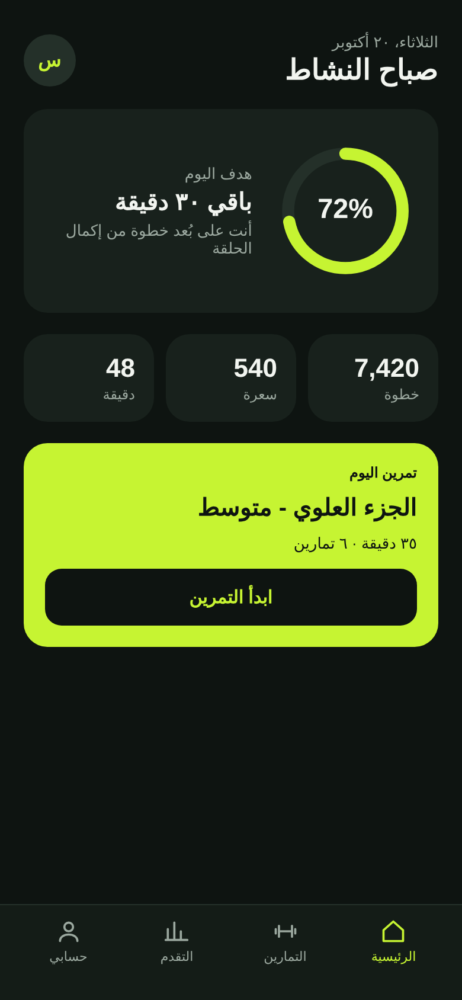
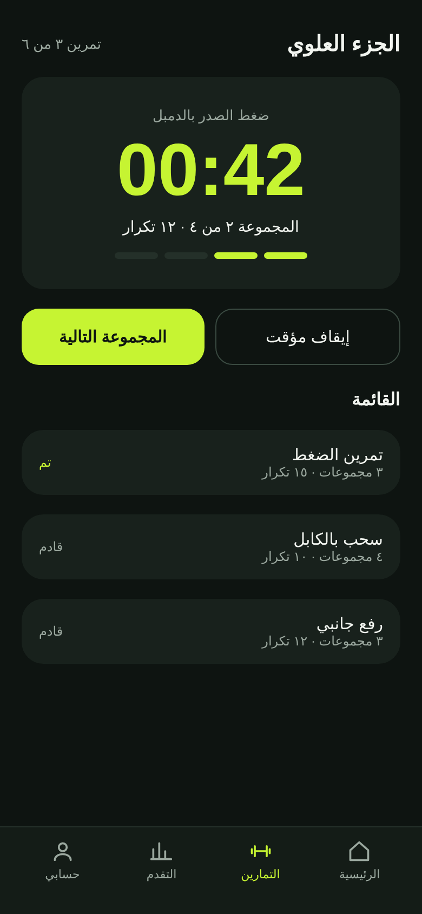
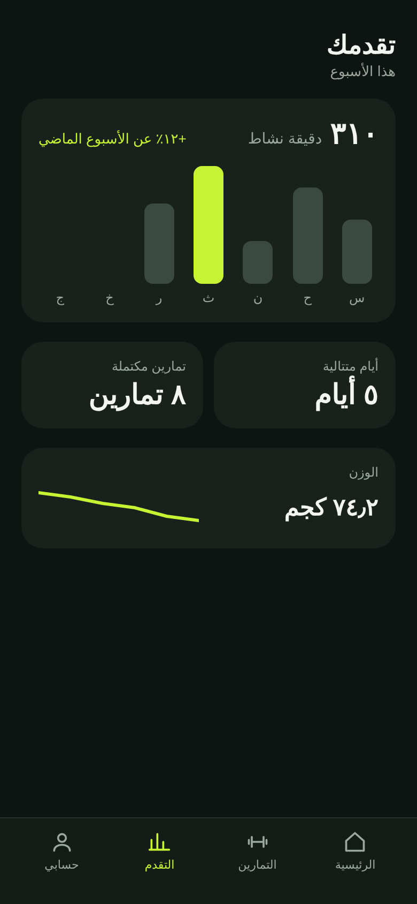
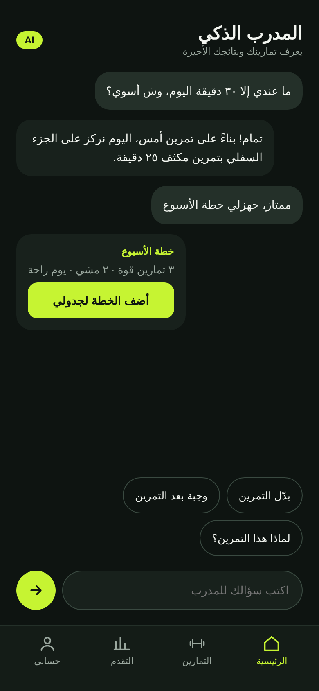
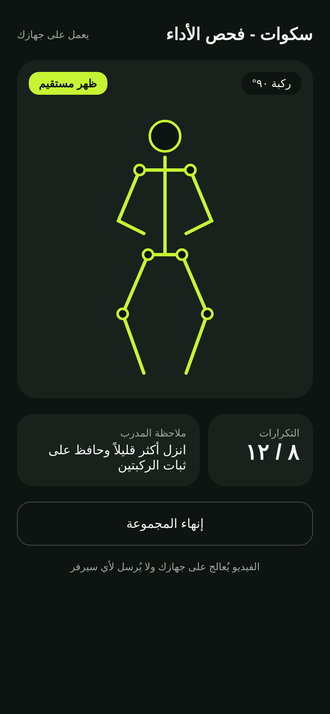
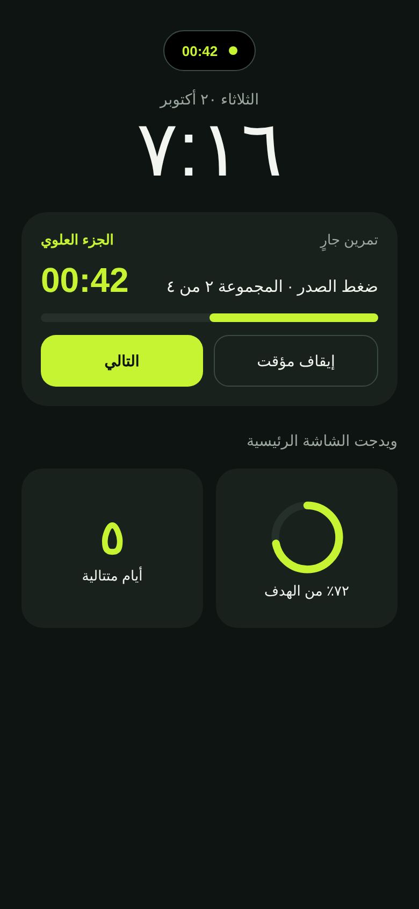

# Fitness App UI

A mobile fitness app UI concept with a full Arabic (RTL) interface and a dark theme. It features an AI coach, on-device camera form checking, and Live Activity / home-screen widgets.

> This is a design concept (UI/UX). The screens are designed; the technologies listed below are planned for a future implementation.

## Screens

| Home | Workout | Progress |
|:---:|:---:|:---:|
|  |  |  |

| AI Coach | Form Check | Lock Screen & Widgets |
|:---:|:---:|:---:|
|  |  |  |

## What each screen shows

- **Home:** daily goal ring, quick stats, and today's recommended workout.
- **Workout:** set timer, rep counter, and the exercise list.
- **Progress:** weekly activity, streak, completed workouts, and weight trend.
- **AI Coach:** chat with a coach that knows your recent workouts and builds a weekly plan.
- **Form Check:** real-time squat feedback from the camera with a pose skeleton overlay. Video is processed on the device only.
- **Lock Screen & Widgets:** a Live Activity for the running workout and home-screen widgets for goal and streak.

## View it

Open `index.html` in a browser to see all screens, or open any file in `screens/` on its own. If GitHub Pages is enabled for this repository, the same page is served live.

## Planned technologies

| Feature | Technology |
|---|---|
| AI Coach | Claude API with tool use, to read workout data and build plans |
| Form Check | MediaPipe Pose or Apple Vision, with on-device processing |
| Lock Screen & Widgets | ActivityKit and WidgetKit on iOS; Live Updates and Glance on Android |
| Health data | HealthKit / Health Connect |

## Design decisions

- Dark theme with a single accent color (`#C6F432`) on a `#0E1411` background.
- IBM Plex Sans Arabic typeface.
- Touch targets of at least 44px and readable text contrast.
- Semantic HTML elements (`button`, `input`, `label`) and text alternatives for graphics.
- Arabic-first layout with right-to-left direction throughout.

## Author

programmer.Nora 
